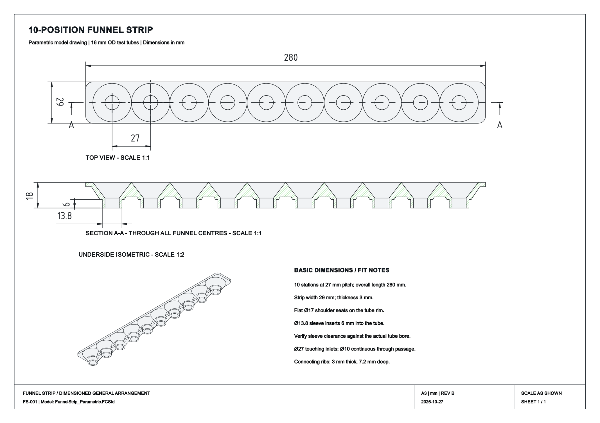

# 10-Position Test Tube Fraction Collector Funnel Strip

**An editable FreeCAD design for a 10-position, manually indexed liquid-sample collection strip.** Designed around standard 16 mm OD glass test tubes and a commercially available single-row acrylic rack.

Search terms: fraction collector, test tube funnel array, 10-way funnel strip, linear sample collector, Reagenzglasständer, Reagenzglashalter, Probensammler, FreeCAD.

This is a **passive accessory**, not an automated fraction collector: a liquid stream is directed over successive adjacent funnel inlets, with each inlet draining into one tube. Useful for small-volume liquid sampling and prototyping. It is not certified as laboratory instrumentation or for any specific chemical or food-contact application.

## What it looks like

The design has a continuous 280 × 29 mm upper strip, ten touching Ø27 mm funnel inlets, conical drain sections, and short sleeves that locate into test tubes. The original drawing shows the top view, a section through all ten funnels and an underside isometric view.



[View the full-size drawing (PDF)](cad/FunnelStrip_Drawing.pdf) · [View the vector drawing (SVG)](docs/FunnelStrip_Drawing.svg)

## Download the design

| Format | File | Purpose |
|---|---|---|
| **Editable source** | [FreeCAD project (.FCStd)](cad/FunnelStrip_Parametric.FCStd) | Parametric model, editable dimensions and drawing |
| CAD exchange | [STEP model (.step)](cad/FunnelStrip_Final.step) | Import into other CAD applications |
| 3D printing | [STL mesh (.stl)](cad/FunnelStrip_Final.stl) | Import into a slicer; geometry is not parametric |
| Engineering drawing | [PDF (.pdf)](cad/FunnelStrip_Drawing.pdf) | Dimensioned A3 general arrangement |

**Source of truth:** the native FreeCAD file and its original engineering drawing. STEP and STL are exports, not substitutes for the editable source. See [CAD notes](cad/README.md).

## Quick parts list

| Item | Specification | Reference |
|---|---|---|
| Tube rack | Tuuters **E51016**, 10 holes, 1 row, Ø16.5 mm holes; 280 × 70 × 84 mm | [Manufacturer product page](https://www.tuuters.de/reagenzglashalter/aus-acryl/acrylhalter-ohne/10-loch-acryl-reagenzglashalter-16-in-einer-reihe.html) |
| Collection tubes | 10 × smooth-rim glass tubes, **120 × Ø16 mm**, Ø14.4 mm nominal inside, ~16 mL | [Tuuters test tubes](https://www.tuuters.de/reagenzglaeser/reagenzglaeser-ohne.html) (select 120 × 16, no closure) |
| Funnel strip | This design; manufacture from a suitable material/process for your liquid | [Specifications](docs/DESIGN.md) |

The rack and tubes are **third-party products, purchased separately**, and their manufacturer is not affiliated with this project. Use dimensional specifications if substituting components, not just product names. See the [parts and substitutes guide](docs/PARTS.md).

## Core dimensions (mm)

| Parameter | Value |
|---|---:|
| Collector positions / hole pitch | 10 / **27** |
| Overall strip length / width | **280 / 29** |
| Overall model height | **18** |
| Flat strip thickness | **3** |
| Touching funnel inlet diameter | **Ø27** |
| Individual through bore | **Ø10** |
| Tube-rim support shoulder | **Ø17** |
| Tube insertion sleeve / insertion depth | **Ø13.8 / 6** |
| Rib thickness / depth below strip | **3 / 7.2** |

**Measurement provenance:** dimensions for the funnel strip are from the final FreeCAD parameter spreadsheet and drawing (FS-001, Rev B, 2026-10-27). The rack envelope and hole diameter are supplier published; **27 mm rack pitch was estimated from physical ruler photographs**, not supplied as a manufacturer tolerance. Sleeve fit requires verification on your actual tubes.

## How to use the design

1. Obtain the rack and 10 compatible tubes (the tubes do not come with the rack).
2. Measure first-to-last hole centers (9 intervals), tube inside diameter, tube rim and assembled height.
3. Open the native [FreeCAD project](cad/FunnelStrip_Parametric.FCStd) in FreeCAD (drawing created using FreeCAD 1.0.2).
4. Edit **Parameters → column B** to adapt pitch, insertion diameter, opening and the other dimensions; recompute and inspect the final solid.
5. Export your preferred format (STEP for CAD exchange, STL for printing); test two adjacent positions before fabricating the full strip.
6. Install only if sleeves freely enter the tubes and shoulder contact is stable. Collect samples by moving the rack/strip under a controlled stream. Verify actual collection performance before relying on sample separation.

See the [fit and design notes](docs/DESIGN.md), [fabrication and assembly guide](docs/FABRICATION.md), and [parts and substitutes list](docs/PARTS.md).

## Limits and safety

- Nominal clearance: **Ø14.4 mm tube bore − Ø13.8 mm sleeve = 0.6 mm diametral** (0.3 mm radial) before real glass and process tolerances.
- Adjacent inlet mouths *touch*; the upper surface can transfer residual liquid as the assembly moves. **Carryover, splash, drain-down time and retained volume have not been quantified.**
- No specified liquid compatibility, sterility, pressure rating, metrological accuracy or temperature/food safety certification. Select and validate materials/processes for the intended medium and cleaning procedure.
- Real rack and tube dimensions may vary. Confirm all fits before printing a 280 mm part.

## Repository map

```text
cad/                    Native FreeCAD model, original PDF drawing, STEP and STL exports
docs/FunnelStrip_Drawing.png   Preview of the actual drawing
docs/FunnelStrip_Drawing.svg   Vector drawing preview
docs/DESIGN.md          Dimensions, provenance, limitations and fit checks
docs/PARTS.md           Supplier references, parts and substitutes
docs/FABRICATION.md     Editing, fabrication, assembly and verification
docs/REPO_SETUP.md      Repository metadata and release checklist
CONTRIBUTING.md         How to share measured fit results and improvements
LICENSE                 MIT license
```

## Contribute

Measured rack pitch, tube-rim dimensions, material and print settings, photos of successful prints and fluid carryover tests are especially helpful. [Open an issue](https://github.com/zerobline/fraction-collector/issues) with the relevant observations; avoid personal or confidential details.

## License

[MIT](LICENSE) — permissive reuse of original project content. Third-party manufacturer names and externally linked products are not part of this license. **Provided as-is, without warranty.**
